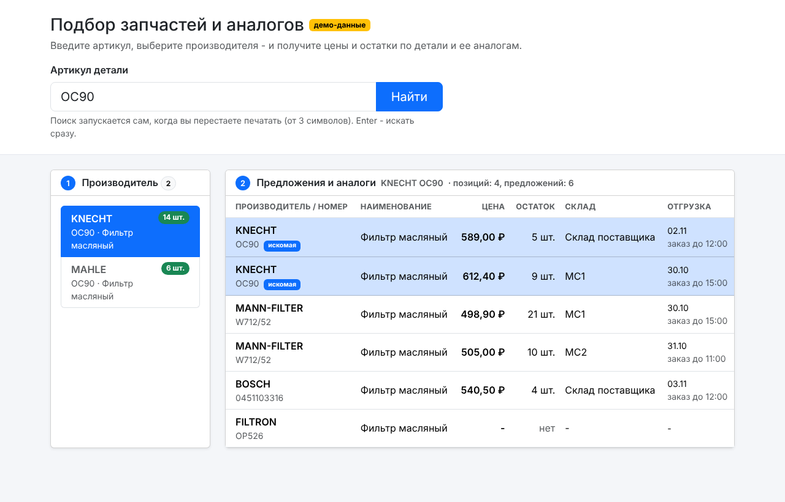
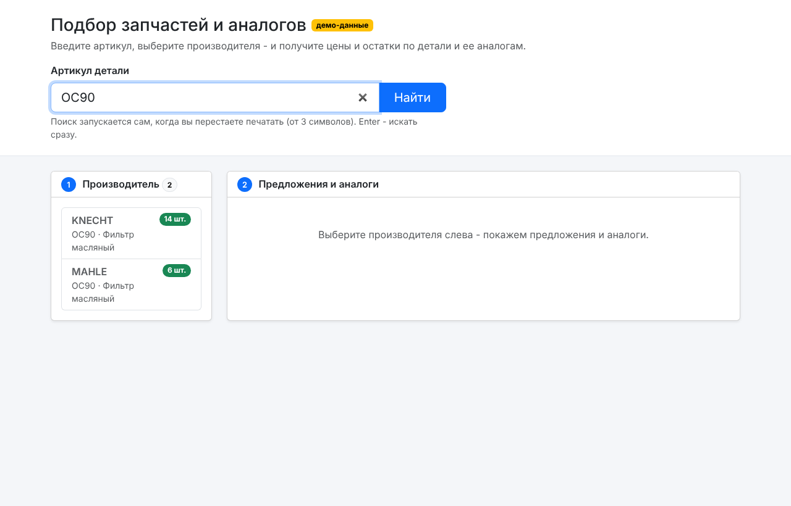
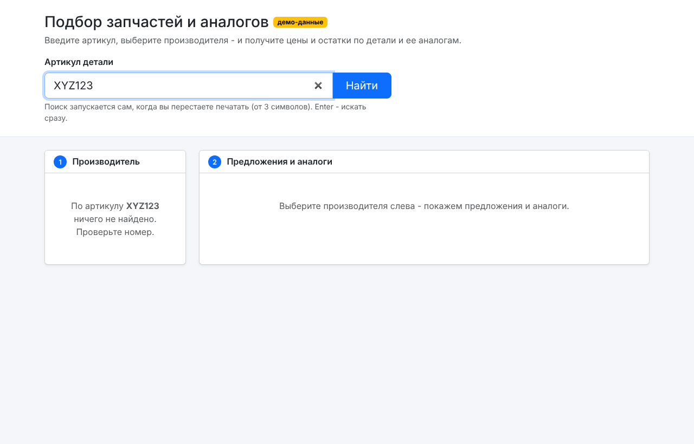
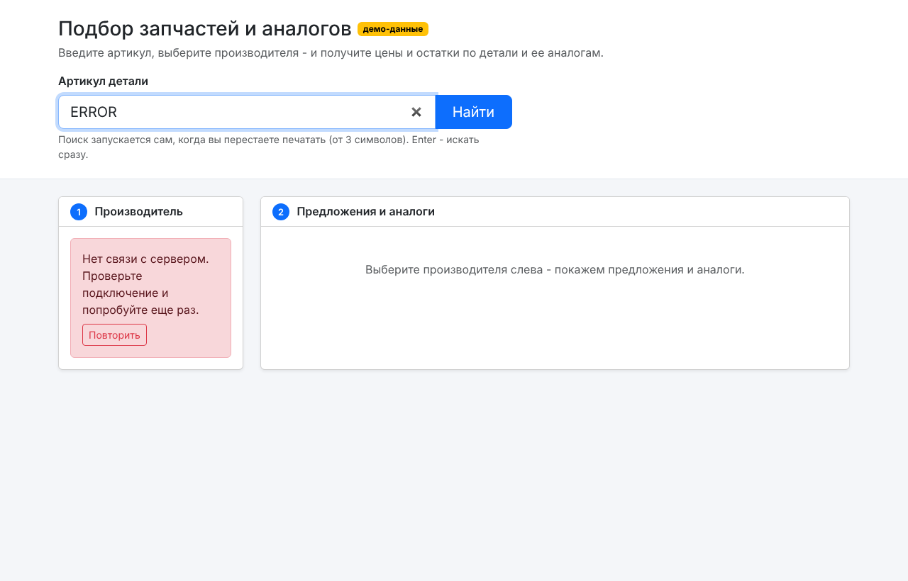
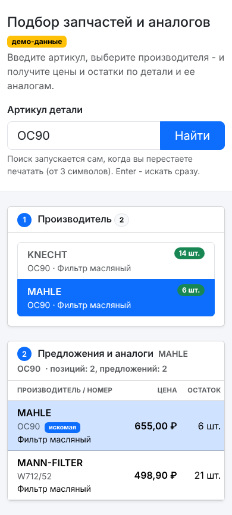

# Подбор автозапчастей и аналогов

Клиентское приложение на React для сервиса "Проценка" Favorit Parts ([документация API](https://lk.favorit-parts.ru/static/wsprice.pdf)). Подбор идет в два шага: артикул -> производитель -> таблица предложений по детали и ее аналогам.



## Стек

- React 18 + Redux Toolkit (createSlice, createAsyncThunk), без TypeScript
- Bootstrap 5 (CSS)
- Vite - сборка и dev-прокси
- Vitest - тесты разбора ответа API

## Запуск

```bash
npm install

# 1. С реальным API: положить ключ покупателя в .env
cp .env.example .env      # и вписать свой FAVORIT_API_KEY
npm run dev               # http://localhost:5173

# 2. Без ключа, на демо-данных (сеть не нужна)
npm run dev:mock

npm test                  # тесты
npm run build             # production-сборка в dist/
```

В демо-режиме работает артикул `OC90` (два производителя, аналоги, товар без остатка). Для проверки ошибок: `ERROR` - сбой сети, `QUOTA` - ошибка сервиса "превышен лимит", любой другой артикул - "ничего не найдено".

## Как работает

**Шаг 1.** Пользователь вводит артикул. Запрос уходит сам после паузы в наборе (600 мс, от 3 символов), Enter или кнопка "Найти" - сразу. Запрос: `?number=...`. Из ответа берутся уникальные производители с наименованием и общим остатком.

**Шаг 2.** Клик по производителю -> запрос `?number=...&brand=...&analogues=on`. Ответ превращается в плоскую таблицу: одна строка = товар на конкретном складе. В строке - производитель и номер, наименование, цена, остаток, склад и дата отгрузки. Искомая деталь подсвечена и стоит первой, аналоги ниже по возрастанию цены.

## Решения, которые стоит пояснить

- **Цена берется из складов (`warehouses[].price`)**, а не из поля `price` товара: в документации оно помечено "не использовать, оставлено для совместимости". Остаток тоже складской (`warehouses[].stock`).
- **Пустой ответ.** Если деталь не найдена, API возвращает массив с одной пустой структурой. Такие элементы отфильтровываются, и пользователь видит "ничего не найдено", а не пустую строку в таблице.
- **Ошибки.** Обрабатываются три уровня: сбой сети, HTTP-ошибка, поле `error` в ответе. Известные ошибки API ("Invalid key client!", "Request quota exceeded!" и т.д.) переводятся на понятный русский. У каждой ошибки есть кнопка "Повторить".
- **Гонки запросов.** Если пользователь печатает дальше или быстро переключает производителей, предыдущий запрос отменяется (`AbortController` через `thunk.abort()`), а ответы со старым `requestId` игнорируются в редьюсере. Медленный старый ответ не перетрет новый.
- **CORS и ключ.** API работает по http и не отдает CORS-заголовки, поэтому браузер ходит на свой `/api`, а Vite проксирует запрос на `api.favorit-parts.ru`. Ключ подставляется в прокси из `.env` и не попадает в клиентский код.
- **Лоадеры** - отдельно для каждого шага; кнопка поиска тоже показывает спиннер.

## Структура

```
src/
  api/
    parse.js        чистые функции: разбор ответа, ошибки, бренды, предложения
    favorit.js      запрос к API (fetch, сетевые ошибки)
    mock.js         демо-данные в формате API
  store/
    searchSlice.js  состояние двух шагов, thunks, защита от гонок
    index.js
  components/
    SearchForm.jsx  поле артикула
    BrandList.jsx   шаг 1 - производители
    OffersTable.jsx шаг 2 - предложения и аналоги
    Status.jsx      Loader / ErrorAlert / Empty
  App.jsx           связка шагов, debounce, отмена запросов
tests/parse.test.js
```

## Для продакшена

Dev-прокси Vite работает только при `npm run dev` / `npm run preview`. На сервере нужен такой же прокси, например nginx:

```nginx
resolver 8.8.8.8;

location ~ ^/api/(.*)$ {
    # ключ добавляется на сервере, в браузер он не уходит
    proxy_pass http://api.favorit-parts.ru/hs/$1?$args&key=ВАШ_КЛЮЧ;
}
```

## Скриншоты

| Производители | Ничего не найдено | Ошибка сети | Мобильная версия |
|---|---|---|---|
|  |  |  |  |

## Как использовался AI

Проект сделан в связке с AI-ассистентом (Claude). Логика разбора ответа API покрыта тестами, все состояния интерфейса (загрузка, пустой ответ, ошибка сервиса, сбой сети, мобильная ширина) проверены вручную на демо-данных - скриншоты выше.
